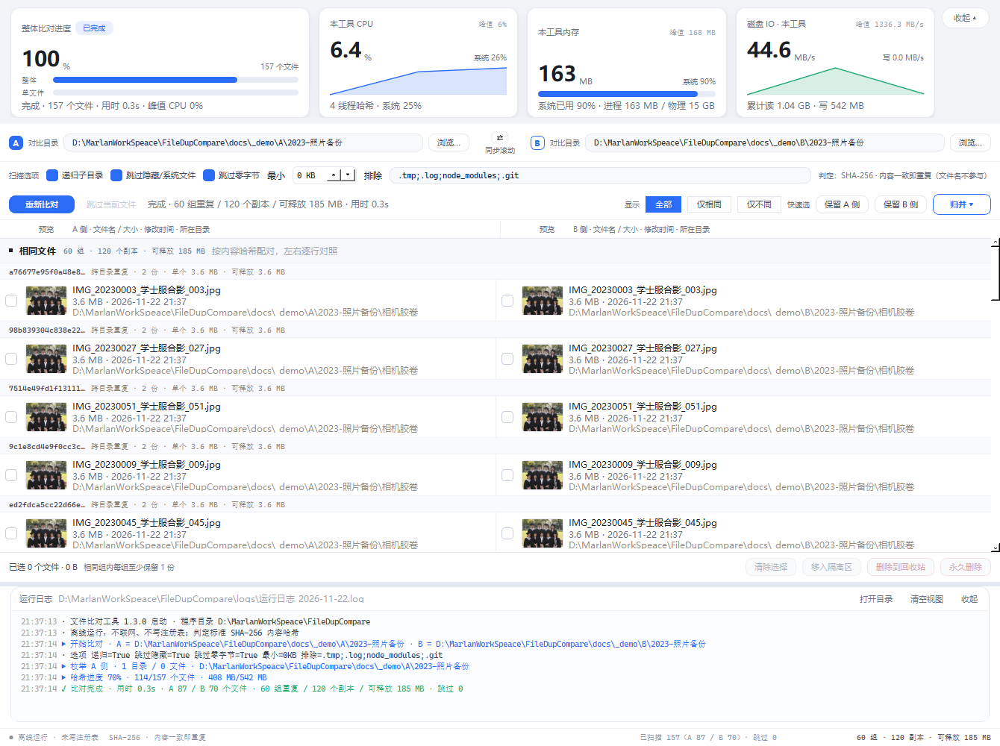
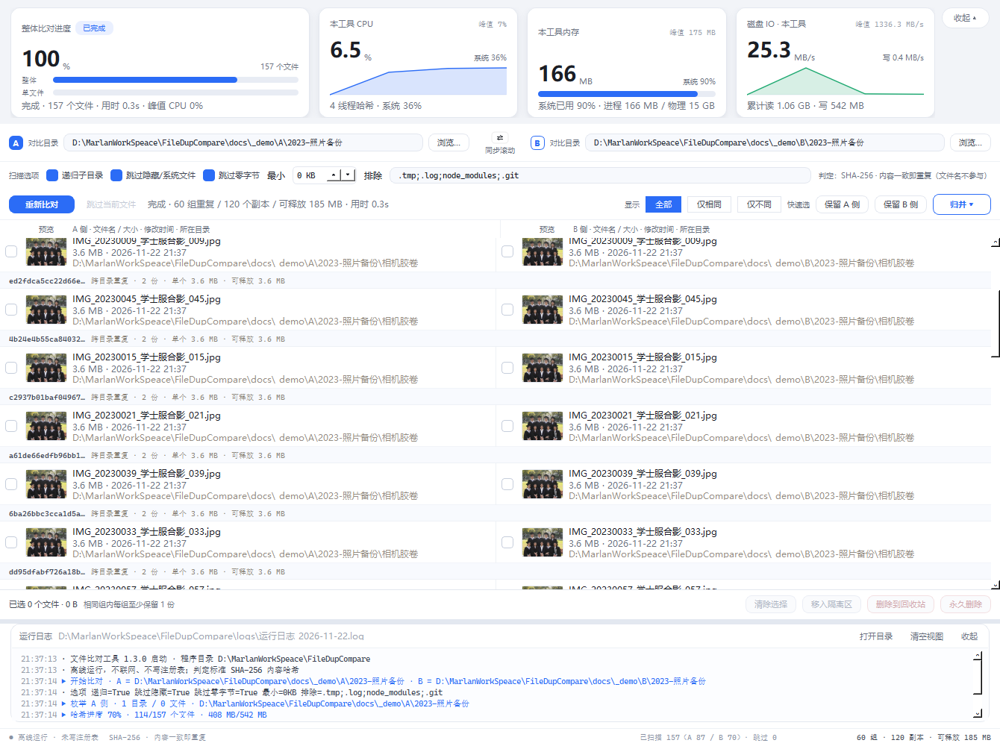
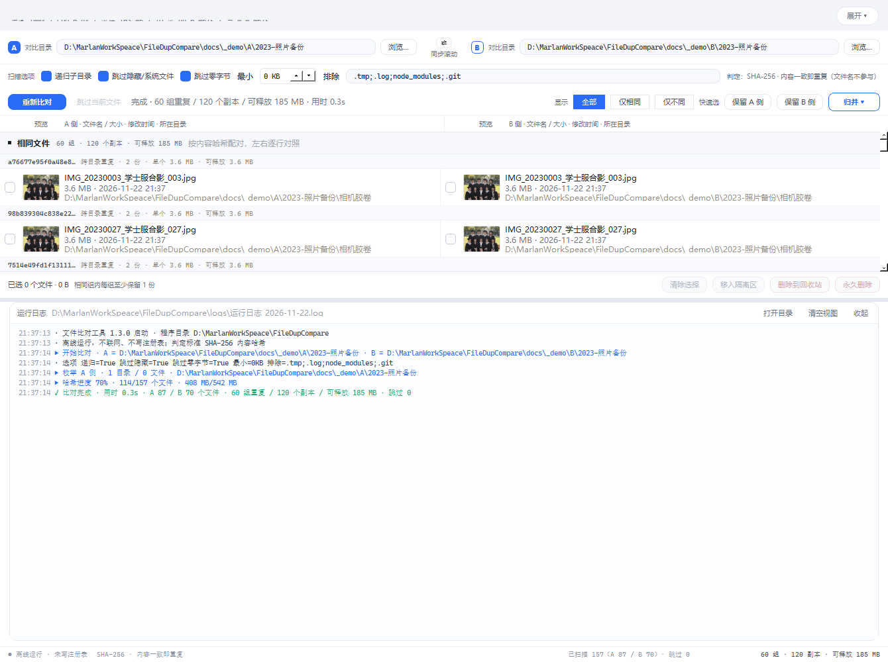

# FileDupCompare · 文件比对工具

一个**免安装、纯离线**的 Windows 文件夹比对工具。左右并排看两个目录，按**文件内容 SHA-256 哈希**判定重复（不看文件名），把该留的留、该清的一键清；还能把一侧独有的内容「归并」到另一侧。

界面是卡片式仪表盘：顶端常驻任务运行监控（整体进度 / 单文件进度 / CPU / 内存 / 磁盘 IO），底部常驻本地运行日志，日志同时逐行落盘。



<p align="center">
  
  
</p>

## 为什么做这个

手机换机、相机导出、多个移动硬盘来回拷贝，最后手里总有几份「看起来一样」的照片和视频：文件名被系统改过、大小一样但内容其实是另一张、一个目录是另一个目录的超集…… 用文件名或大小去重都会误判，只有**内容哈希**能给出确定答案。这个工具就围绕一件事：**把两坨文件按内容对齐，然后让你安全地清理。**

## 功能一览

- **内容级判定**：逐块流式算 SHA-256，边算边报进度，大文件不会把界面拖死；只按内容判重，文件名/时间戳不参与
- **左右对照**：同一滚动轨道，滚一侧另一侧必然同步；先「相同组」后「仅 A / 仅 B / 跳过项」，行内带缩略图（图片走系统缩略图接口、视频出封面 + 时长）
- **分组保留约束**：同一组重复至少保留 1 份，勾满整组会被拦下
- **批量处置**：移入隔离区 / 删除到回收站 / 永久删除，全部先出预览清单再执行，绝不覆盖同名文件
- **一键归并**：把「A 侧独有、B 侧缺失」的内容各搬一份到 B（同侧多份重复只搬一份），完成后可核对该侧是否还有独有内容；后台线程执行 + 进度 + 可取消，**每个文件一行日志即时落盘**
- **可撤销**：移动/归并都会写 `logs\操作日志_YYYY-MM-DD.csv`；「撤销本次移动」按记录反向搬回，另有「撤销上次归并」可读当天日志把最近一批归并搬回原位（重启后仍可用）
- **性能监控**：整体进度条 + 单文件进度条、近 6 秒滑动窗口测速、ETA 区间（`剩 MM:SS ~ MM:SS`）、本工具 CPU/内存/磁盘 IO 实时曲线与峰值
- **本地日志**：`logs\运行日志_YYYY-MM-DD.log` 逐行 flush，界面同步流式显示；日志面板高度可拖拽调整
- **容错**：6 秒无字节进展触发「疑似卡住」提示，可**按文件**跳过（列表逐条选）；自动跳过 OneDrive / 坚果云 等「仅在线」云占位文件（`OFFLINE` / `RECALL_ON_OPEN` / `RECALL_ON_DATA_ACCESS`）
- **零痕迹**：不写注册表、不装服务、不需要管理员权限、**全程无网络请求**

## 截图说明

| 图 | 看什么 |
|---|---|
| `01-overview.png` | 完整界面：四张监控卡（整体进度含「整体/单文件」双进度条、CPU、内存、磁盘 IO）、左右对照结果、底部运行日志 |
| `02-collapsed-log.png` | 监控带收起成一行摘要（按钮位置固定不动），日志区拖高看完整事件流 |
| `03-result-rows.png` | 结果行细节：哈希分组带、缩略图、每行独立勾选框、左右严格对齐 |
| `00-icon.png` | 应用图标（钢蓝底 + 白色双窗 + 对勾，与界面同色系） |

## 快速开始

### 方式一：直接用打包好的 exe（推荐）

1. 到 [Releases](https://github.com/1130223977cx-stack/FileDupCompare/releases/latest) 下载 `FileDupCompare_v1.3.0_portable_win64.zip`
2. 解压到任意目录（U 盘也行），双击 `FileDupCompare\FileDupCompare.exe`
3. 删除目录即卸载

要求：Windows 10 1809+ / Windows 11 x64。

### 方式二：跑源码

```bat
python -m pip install PySide6 Pillow
python main.py
```

或双击 `run.bat`。需要 Python 3.11+。

## 使用流程

1. **选目录**：左右两个「浏览…」选 A、B，中间 `⇄` 可对调
2. **选项**：递归子目录 / 跳过隐藏系统文件 / 跳过零字节 / 最小大小 / 排除扩展名与目录名（分号分隔）
3. **开始比对**：状态栏与监控卡显示枚举进度 → 字节进度 / 速度 / ETA / 当前最大文件百分比；随时可取消（取消不改动任何文件）
4. **看结果**：相同组左右逐行配对，同组多副本按份数对齐；多出来那侧显示「无对应副本」
5. **勾选**：每行独立勾选，同组至少留 1 份
6. **处置**：移入隔离区 / 删除到回收站 / 永久删除（先预览）
7. **归并**：工具条「归并 ▾」，把一侧独有内容搬到另一侧

## 安全设计

- 移动/删除**永不覆盖**目标同名文件：冲突自动加 `(1)(2)` 序号
- 默认删除走 Windows 回收站（可手工还原）；永久删除单独按钮 + 预览红字提示
- 只处理本次扫描过、且位于两个根目录内的文件；跳过项永不参与处置
- 执行前程序层强制校验「每组至少保留一份」
- 每次处置/归并写 CSV：时间 / 动作 / 源路径 / 目标路径 / 大小 / 哈希 / 结果 / 备注
- 移动是同卷 `rename`（原子、瞬时）；跨卷才是真拷贝，中途取消也不会留下半截文件

## 技术实现

单文件 `main.py`（约 2400 行），PySide6 纯代码 UI，无 QML、无第三方 UI 框架。

```
main.py
├─ 常量与样式        QSS 主题（#F2F4F8 底 / 白卡片 / #2B6CF6 主色）
├─ SysProbe          ctypes 调 Win32：GetProcessTimes / GetProcessMemoryInfo /
│                    GetProcessIoCounters / GlobalMemoryStatusEx，算本进程 CPU、RSS、IO 速率
├─ sha256_of         流式哈希，块回调进度 + 可取消 + 可跳过
├─ ScanWorker        目录枚举 → 线程池 as_completed 算哈希 → 按哈希分组
│                    6 秒滑动窗口测速、ETA 区间、卡死看门狗（stalled 信号）
├─ MergeWorker       归并搬文件，逐条信号 + 可取消
├─ ThumbService      缩略图后台队列（2 线程），首次绘制才请求，退化 = 类型块 + 时长
├─ MonitorBand       四张监控卡 + 双进度条 + 迷你面积图 + 折叠
├─ LogPane           流式日志 + 落盘，往上翻时不抢滚动位置
└─ MainWindow        目录选择、筛选、结果渲染（60 行一批懒加载）、批量处置、归并、撤销
```

关键取舍：

- **`as_completed` 而不是 `map`**：`map` 按提交顺序返回，一个大文件排前面会把其余线程的成果全压住，进度看起来「卡死」——这是 v1.0 的原始 bug
- **首次绘制才生成缩略图**：一次性给几百行解码缩略图会直接卡住 UI
- **结果分批 60 行 + 滚动到底续加**：几百上千行时避免一次性建控件
- **哈希只算一遍**：同大小的文件走同一遍流式读取，不做两段式（先大小预筛再哈希）

## 目录结构

```
FileDupCompare/
├─ main.py                      主程序（扫描引擎 + 界面）
├─ run.bat                      源码启动
├─ 打包.bat                     PyInstaller 打包
├─ FileDupCompare.spec          打包配置
├─ app.ico                      图标（16~256px 多尺寸）
├─ README.md
├─ docs/
│  ├─ requirements/需求说明书_RFP_v1.0.md   需求基线（FR/NFR/任务分解）
│  ├─ prototype/界面原型.html + assets/      交互原型
│  └─ screenshots/                           本 README 用图
└─ tests/
   ├─ smoke.py       窗口/渲染/筛选/保留策略/扫描/归并候选/真实移动
   ├─ smoke2.py      800MB 大文件 + 300 小文件的进度专项
   ├─ smoke3.py      端到端 UI：四卡数字、日志落盘、折叠展开、按钮位置不变
   ├─ smoke4.py      归并专项：逐条日志、不覆盖、可取消
   ├─ shot.py        离屏抓图（假数据）
   ├─ shot2.py       扫描进行中抓图（真实大文件）
   └─ shot_repo.py   生成 README 用截图（造演示照片库）
```

运行期在程序目录生成：`config.json`（上次目录与选项）、`logs\`（运行日志 + 操作日志 CSV）、`隔离区\`。这些都已 `.gitignore`。

## 自检

```bat
python tests\smoke.py
python tests\smoke2.py
python tests\smoke3.py
python tests\smoke4.py
```

四个脚本分别覆盖核心逻辑、大文件进度、端到端 UI、归并安全；输出末行为 `ALL OK` 即通过。

## 打包

```bat
python -m PyInstaller --noconfirm --onedir --windowed --name FileDupCompare --icon app.ico main.py
```

产物 `dist\FileDupCompare\`（约 90 MB，PySide6 运行时占大头）。`--onefile` 可出单文件包，但冷启动从 1~2 秒延长到 5~8 秒。

## 版本记录

| 版本 | 内容 |
|---|---|
| v1.3.1 | **修归并会重复搬运的严重缺陷**：目标侧文件若在扫描时被「跳过」（读不了 / 手工跳过），此前归并只看「比对结果里有没有」，会误判成「另一侧缺失」，把源侧那份再搬一份过去，且目标路径按源相对路径拼接会多套一层目录。现改为：目标侧被跳过文件按「同名 + 同尺寸」建索引，命中的一律不搬，预览里单列「〔不搬〕」并写明原因；预览标题与确认按钮显式带上两侧绝对路径（`从 A（D:\照片）剪切到 B（F:\照片）`）；归并结果弹窗同时标明方向。另新增检索「撤销上次归并」：按当天操作日志把最近一批归并移动反向搬回，会话退出后仍可用 |
| v1.3.0 | 单个文件跳过（列表逐条选）；整体/单文件双进度条；ETA 区间；日志区可拖拽调高；收起按钮 64×28 整块可点且位置固定；四卡标题同高；结果行 60 行分批 + 异步缩略图（修「比对完成后拖动卡死」）；归并后台化 + 进度 + 取消 + 逐条日志；归并按钮放大；同色系应用图标 |
| v1.2.0 | 卡片式仪表盘换皮；顶端四卡监控（进度 / CPU / 内存 / 磁盘 IO + 迷你曲线 + 峰值）；底部流式运行日志并落盘；修 SysProbe 未声明 argtypes 导致指标全 0 |
| v1.1.0 | 修「卡在某个文件不动」：`as_completed` 完成即上报、字节级进度、6 秒卡死看门狗 + 跳过按钮、枚举阶段进度、自动跳过云占位文件 |
| v1.0.0 | 首个可用版本：左右对照、SHA-256 判重、缩略图、逐行勾选批量处置、归并、免安装包 |

## 已知限制

- 视频缩略图走 Windows 缩略图接口；系统缺编码（如 HEVC）时退化为「类型块 + 时长」，双击用系统播放器打开。未内置 ffmpeg
- 不落盘哈希缓存，二次扫描仍需重算
- 处置（隔离/删除）仍是同步执行，一次几万个文件时界面会短暂无响应（归并已后台化）
- 4 线程并行哈希在机械硬盘上会互相抢磁道，速度可能低于单线程；尚未提供「线程数 / 限速」开关
- 仅 Windows：UI 与 Win32 探针（IO 计数器、缩略图、回收站）都是 Windows 实现

## 说明

本项目在 AI 辅助下完成（需求梳理、原型、实现、自检脚本均在同一会话中迭代产出），代码与文档以仓库现状为准。
